# Etapas

1. [Etapa I](./Arquivos/etapa1.sql)

2. [Etapa II](./Arquivos/etapa2.sql)

## Desafio apresentado

Dada uma base de dados de uma locadora NÃO normalizada, devemos aplicar as formas normais (3FN) e convertê-lo para o Modelo Relacional e depois do Modelo Relacional para o Modelo DImensional. Deve ser feito o modelo lógico de cada um.

## Etapa I


### Base de dados - Locacao

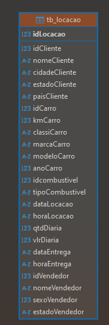

Após o download da base de dados, usando o DBeaver, foi possível observar cada um dos atributos dessa tabela. 

Podemos observar que nela há muita informação duplicada e muitas dependencias indiretas, não seguindo as 3FN:

**1FN:** eliminar dados multivalorados e registros não atômicos

- Os atributos estão atômicos (um único registro), mas as colunas de "nomeCliente", "cidadeCliente", "estadoCliente" e "paisCliente", se repetem para o mesmo cliente em várias locações. Isso também acontece com as colunas referentes aos dados de carro e o mesmo para vendedor.  

**2FN**: remover dependências parciais

- Como a chave primária da tabela é "idLocacao", então para seguir a 2FN, todos os atributos devem depender unicamente dela. mas isso não acontece, atributos do cliente dependem de "idCliente", atributos de carro dependem de "idCarro", assim como atributos de vendedor e atributos de combustível.

**3FN**: remover dependências transitivas

- O atributo "estadoCliente" depende de "cidadeCliente" que depende de "idCliente".

**Solucionando:**
para seguir a 1FN, é necessário criar entidades seperadas afim de que cada entidade contenha apenas os proprios atributos sem repetição.
```
Cliente (idCliente, nome, cidade, estado, pais)
Carro (idCarro, km, classi, marca, modelo, ano, idCombustivel)
Combustivel (idCombustivel, tipo)
Vendedor (idVendedor, nome, sexo, estado)
Locacao (idLocacao, idCliente, idCarro, idVendedor, dataLocacao, horaLocacao, dataEntrega, horaEntrega, qtdDiaria, valorDiaria)
```
Fazendo isso, a 2FN e 3FN também já são respeitadas, não havendo mais dependencias parciais e nem transitivas.

Criamos então, o diagrama relacional, utilizando a ferramenta do site [Br Modelo web](https://www.brmodeloweb.com/).


Pronto, agora a base de dados foi normalizada e está seguindo as 3FN. 

Utilizando esse diagrama, foi implementado em SQL a criação das novas tabelas e inserções desses dados em cada uma, conforme o arquivo da [Etapa I](./Arquivos/etapa1.sql).

### Explicações de algumas decisões na criação das tabelas

- Na tabela "Locacao" foi criado o atributo valorTotal que é o resultado de "qtdDiaria * valorDiaria" para armazenar a renda gerada naquela locação, já que parecia ser um dado muito útil para consultas. 

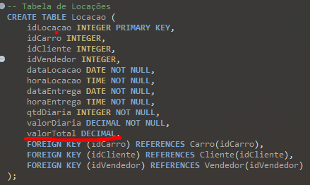

- Os atributos de data estavam no formato DATETIME, mas so armazenavam uma data e os atributos de hora já estão em TIME. Logo o atributo foi criado como DATE (como mostrado acima). O restante dos atributos foi seguindo conforme a tabela original (tb_locacao).

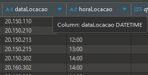

- Com exceção do atributo "sexo" na tabela "Vendedor" e do atributo criado "ValorTotal" na tabela "Locacao", todos os outros foram definidos como NOT NULL, já que são dados são necessários para registrar uma locação. 

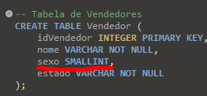

- O atributo "tipo" na tabela "Combustível" foi criado como UNIQUE para garantir um unico tipo de combustivel na tabela. O mesmo ocorre com "chassi" em carro, já que deve ser um atributo unico de cada carro (podendo também ser utilizada como chave alternativa).

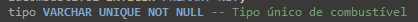
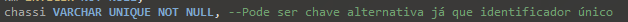

### Explicações de alguns detalhes nas inserções nas tabelas:

- Para que cada carro tenha o dado correto em "km", foi necessário encontrar a quilometragem atual, já que na tabela antes do normalização, o mesmo carro aparece várias vezes com quilometragens diferentes. Para isso foi feito um WITH antes do INSERT.

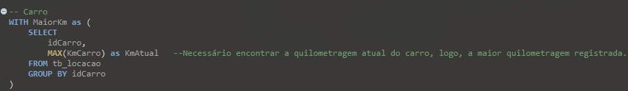

- As datas e horas na locação tiveram que ser formatadas. A data não se encontrava em um formato reconhecido por STRFTIME() para extrair o dia, mes, ano e dia semana na próxima etapa de modelagem dimensional. 

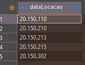

Para resolver, antes do INSERT um WITH para formatar 

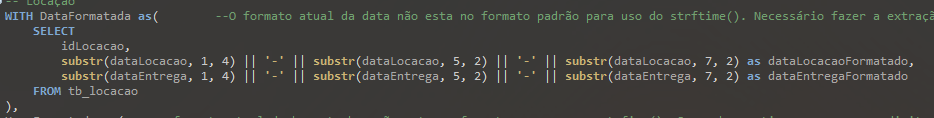

A hora quando possuia um unico digito, também se tornava fora do padrão do STRFTIME() resultando em NULL para extrair hora. Para resolver, foi necessário adicionar um '0' no caso da hora ser menor que '10' para que haja dois digitos. No código a uma explicação de cada função utilizada para isso.

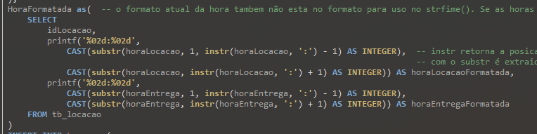

### Fazendo consultas nas tabelas:

```sql
SELECT * FROM Carro
```
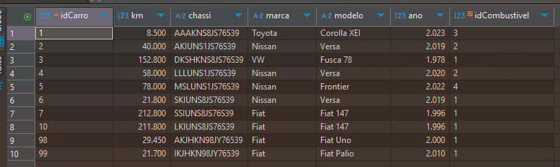
```sql
SELECT * FROM Cliente
```
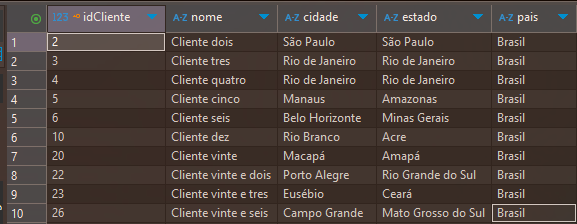
```sql
SELECT * FROM Combustivel
```
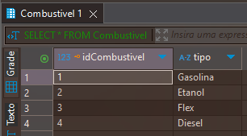
```sql
SELECT * FROM Locacao
```
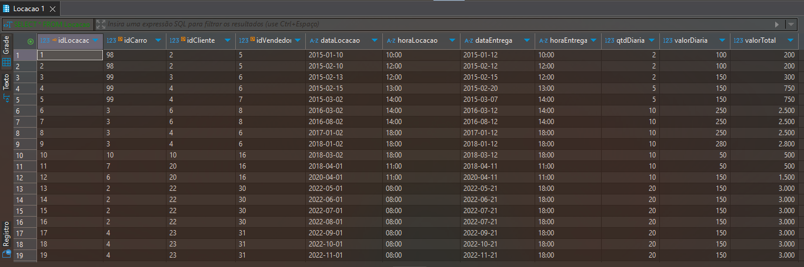
```sql
SELECT * FROM Vendedor
```
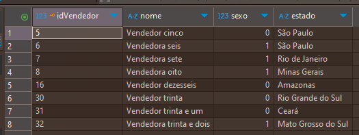

## Etapa II

