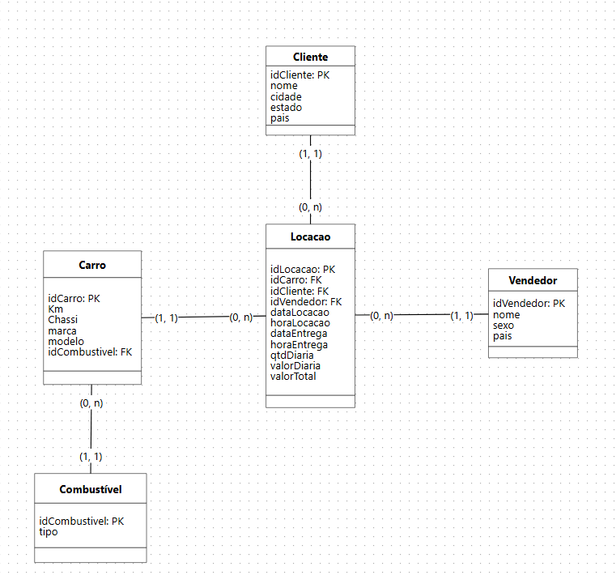

# Etapas

1. [Etapa I](./Arquivos/etapa1.sql)

2. [Etapa II](./Arquivos/etapa2.sql)

## Problema apresentado

Dada uma base de dados de uma locadora NÃO normalizada, devemos aplicar as formas normais (3FN) e convertê-lo para o Modelo Relacional e depois do Modelo Relacional para o Modelo DImensional.

## Base de dados - Locacao

Após o download da base de dados, usando o DBeaver, foi possível observar cada um dos atributos dessa tabela. 

Podemos observar que há 1FN é respeitada, já que há apenas registros únicos garantindo a atomicidade.

Porém, já a 2FN e 3FN não são respeitadas. Há várias chaves compostas, gerando muitas dependências particias e transitivas entre os atributos. 

Para seguir as formas normais, deve-se criar tabelas afim de eliminar essas dependências.
No caso dessa base de dadas, os nomes dos atributos ainda contém explicitamente a qual entidade o atributo faz referência. 

Criamos então, o diagrama relacional, utilizando a ferramenta do site [Br Modelo web](https://www.brmodeloweb.com/).

Pronto, agora a base de dados foi normalizada e está seguindo as 3FN. 

Utilizando esse diagrama, podemos implementar em SQL 

