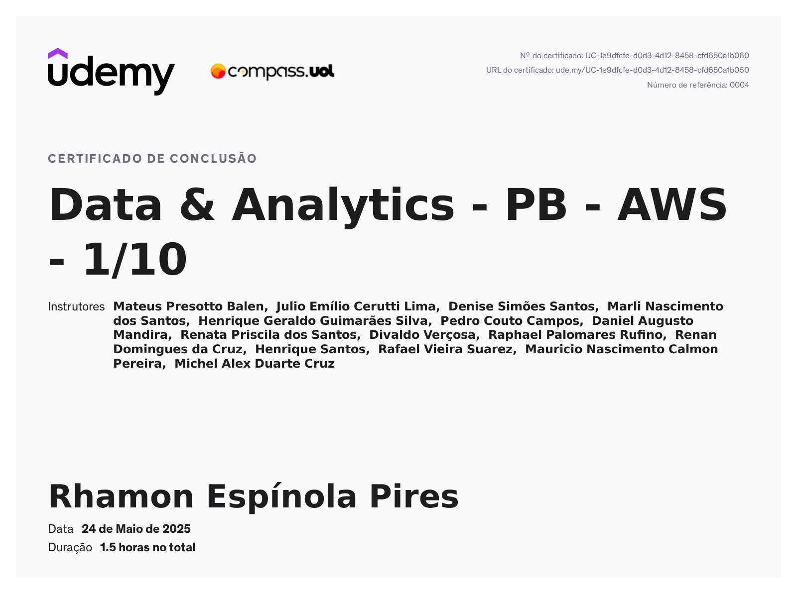

# Resumo

Nessa Sprint 1, na Semana 1 tivemos introdução ao Scrum, uso de ferramenta do GitHub e Markdown. A semana 2 foi referente a banco de dados e estudo do SQL, com o desafio referente ao assunto.

# Desafio

- [Arquvos](./Desafio/Arquivos/)
- [README.MD](./Desafio/README.md)

# Exercícios

## Exercicios I de 1-7 (Biblioteca)
1. [Resposta Ex1.](./Exercicios/Exercicios_I_1_7_Biblioteca/ex1.sql)

2. [Resposta Ex2.](./Exercicios/Exercicios_I_1_7_Biblioteca/ex2.sql)

3. [Resposta Ex3.](./Exercicios/Exercicios_I_1_7_Biblioteca/ex3.sql)

4. [Resposta Ex4.](./Exercicios/Exercicios_I_1_7_Biblioteca/ex4.sql)

5. [Resposta Ex5.](./Exercicios/Exercicios_I_1_7_Biblioteca/ex5.sql)

6. [Resposta Ex6.](./Exercicios/Exercicios_I_1_7_Biblioteca/ex6.sql)

7. [Resposta Ex7.](./Exercicios/Exercicios_I_1_7_Biblioteca/ex7.sql)

## Exercicios I de 8-16 (Loja)

8. [Resposta Ex8.](./Exercicios/Exercicios_I_8_16_Loja/ex8.sql)

9. [Resposta Ex9.](./Exercicios/Exercicios_I_8_16_Loja/ex9.sql)

10. [Resposta Ex10.](./Exercicios/Exercicios_I_8_16_Loja/ex10.sql)

11. [Resposta Ex11.](./Exercicios/Exercicios_I_8_16_Loja/ex11.sql) 

12. [Resposta Ex12.](./Exercicios/Exercicios_I_8_16_Loja/ex12.sql)

13. [Resposta Ex13.](./Exercicios/Exercicios_I_8_16_Loja/ex13.sql)

14. [Resposta Ex14.](./Exercicios/Exercicios_I_8_16_Loja/ex14.sql)

15. [Resposta Ex15.](./Exercicios/Exercicios_I_8_16_Loja/ex15.sql)

16. [Resposta Ex16.](./Exercicios/Exercicios_I_8_16_Loja/ex16.sql)

## Exercicios II (Exportação de Dados)

### Etapa 1

- [Os 10 livros mais caros](./Exercicios/Exercicios_II_Exportacao/1_10livros_mais_caros.csv)

### Etapa 2

- [As 5 editores com maior quantidade de livros](./Exercicios/Exercicios_II_Exportacao/2_5editoras_maior_qntdd_livros.csv)

# Evidências

# Certificados

Certificado do Data & Analytics - PB - AWS - 1/10

