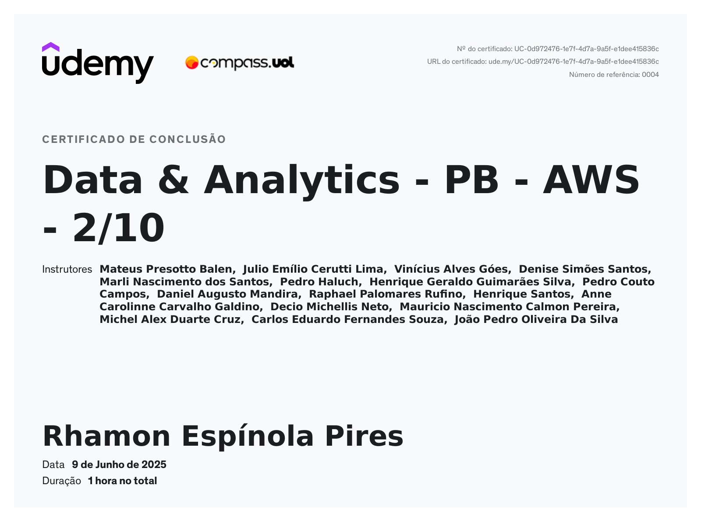

# Resumo

# Desafio

- [Arquivos](./Desafio/Arquivos/)
- [README.MD](./Desafio/README.md)

# Exercícios

## Exercicios Python 1/4 Básico (1-14) 

1. [Resposta Ex1.](./Exercicios/Exercicios_1_4_basico/ex1.py)
2. [Resposta Ex2.](./Exercicios/Exercicios_1_4_basico/ex2.py)
3. [Resposta Ex3.](./Exercicios/Exercicios_1_4_basico/ex3.py)
4. [Resposta Ex4.](./Exercicios/Exercicios_1_4_basico/ex4.py)
5. [Resposta Ex5.](./Exercicios/Exercicios_1_4_basico/ex5.py)
6. [Resposta Ex6.](./Exercicios/Exercicios_1_4_basico/ex6.py)
7. [Resposta Ex7.](./Exercicios/Exercicios_1_4_basico/ex7.py)
8. [Resposta Ex8.](./Exercicios/Exercicios_1_4_basico/ex8.py)
9. [Resposta Ex9.](./Exercicios/Exercicios_1_4_basico/ex9.py)
10. [Resposta Ex10.](./Exercicios/Exercicios_1_4_basico/ex10.py)
11. [Resposta Ex11.](./Exercicios/Exercicios_1_4_basico/ex11.py) 
12. [Resposta Ex12.](./Exercicios/Exercicios_1_4_basico/ex12.py)
13. [Resposta Ex13.](./Exercicios/Exercicios_1_4_basico/ex13.py)
14. [Resposta Ex14.](./Exercicios/Exercicios_1_4_basico/ex14.py)

## Exercicios Python 2/4 Avançado I (15-19)

15. [Resposta Ex15.](./Exercicios/Exercicios_2_4_avancado_I/ex15.py)
16. [Resposta Ex16.](./Exercicios/Exercicios_2_4_avancado_I/ex16.py)
17. [Resposta Ex17.](./Exercicios/Exercicios_2_4_avancado_I/ex17.py)
18. [Resposta Ex18.](./Exercicios/Exercicios_2_4_avancado_I/ex18.py)
19. [Resposta Ex19.](./Exercicios/Exercicios_2_4_avancado_I/ex19.py)

## Exercicios Python 3/4 Avançado I (20-26)

20. [Resposta Ex20.](./Exercicios//Exercicios_3_4_avancado_II/ex20.py)
21. [Resposta Ex21.](./Exercicios//Exercicios_3_4_avancado_II/ex21.py)
22. [Resposta Ex22.](./Exercicios//Exercicios_3_4_avancado_II/ex22.py)
23. [Resposta Ex23.](./Exercicios//Exercicios_3_4_avancado_II/ex23.py)
24. [Resposta Ex24.](./Exercicios//Exercicios_3_4_avancado_II/ex24.py)
25. [Resposta Ex25.](./Exercicios//Exercicios_3_4_avancado_II/ex25.py)
26. [Resposta Ex26.](./Exercicios//Exercicios_3_4_avancado_II/ex26.py)

## ETL

- [ETL](./Exercicios/Exercicios_4_4_ETL/etl.ipynb)

# Evidências

Aqui vão constar evidencias dos exercícios a respeito da entrada e o resultado obtido com sucesso.

## Exercicios Básicos de 1-14

- **EXERCÍCIO 1:**

- **EXERCÍCIO 2:**

- **EXERCÍCIO 3:**

- **EXERCÍCIO 4:**

- **EXERCÍCIO 5:**

- **EXERCÍCIO 6:**

- **EXERCÍCIO 7:**

- **EXERCÍCIO 8:**

- **EXERCÍCIO 9:**

- **EXERCÍCIO 10:**

- **EXERCÍCIO 11:**

- **EXERCÍCIO 12:**

- **EXERCÍCIO 13:**

- **EXERCÍCIO 14:**

## Exercicios Avançados I (15-19)

- **EXERCÍCIO 15:**

- **EXERCÍCIO 16:**

- **EXERCÍCIO 17:**

- **EXERCÍCIO 18:**

- **EXERCÍCIO 19:**

## Exercicios Avançados II (20-26)

- **EXERCÍCIO 20:**

- **EXERCÍCIO 21:**

- **EXERCÍCIO 22:**

- **EXERCÍCIO 23:**

- **EXERCÍCIO 24:**

- **EXERCÍCIO 25:**

- **EXERCÍCIO 26:**

## ETL 

# Certificados

Certificado do Data & Analytics - PB - AWS - 2/10

