# Etapas

1. [Etapa I - etl.py](./Arquivos/etl/etl.py)

2. [Etapa II - job.py](./Arquivos/job/job.py)

3. [Etapa III - docker-compose.yml](./Arquivos/docker-compose.yml)

# Desafio apresentado

O desafio consiste em realizar a limpeza e análise de dados a partir do arquivo `concert_tours_by_women.csv`, que contém informações sobre turnês musicais. O arquivo possui dados provenientes de webscraping, podendo apresentar erros, dados incompletos ou desorganizados.

O objetivo é criar um script `etl.py` que limpe esses dados, gere um novo arquivo estruturado (`csv_limpo.csv`) e, a partir dele, outro script `job.py` que vai responda as perguntas apresentadas em um arquivo de texto `respostas.txt` e gere gráficos `Q4.png` e `Q5.png`. 

Toda a solução precisa rodar dentro de containers Docker, que vão se comunicar entre si através de um `docker-compose`. Além disso, os dados processados devem ser salvos em uma pasta local, que funciona como um volume compartilhado entre os containers.

## Etapa I - etl.py

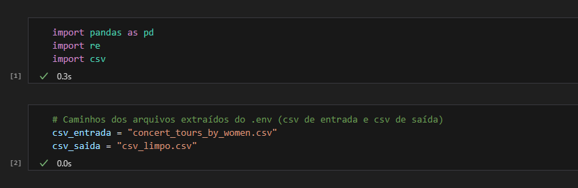

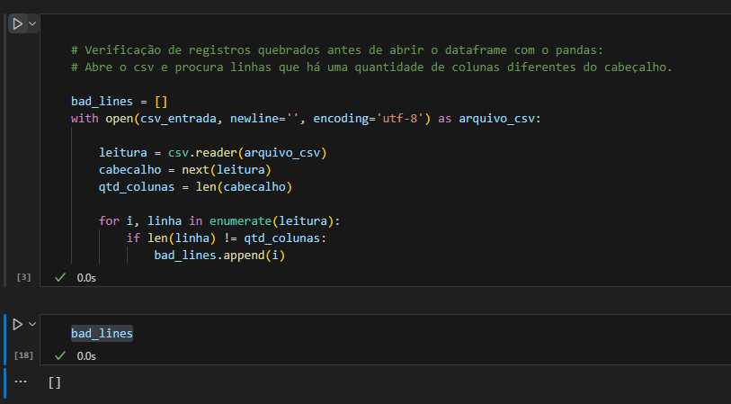

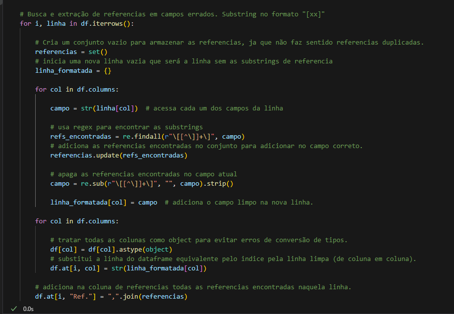

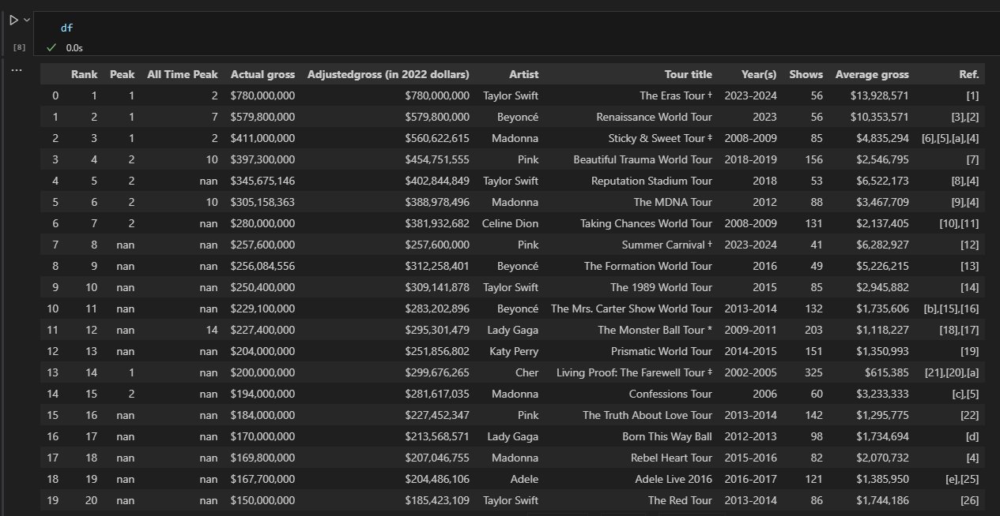

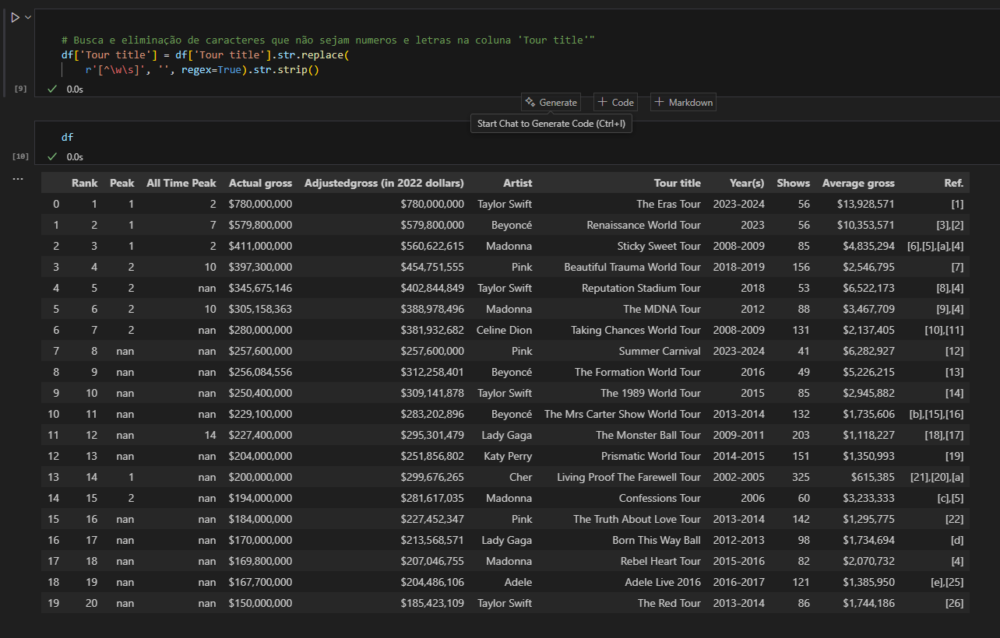

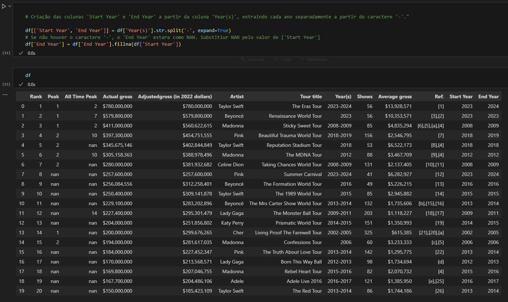

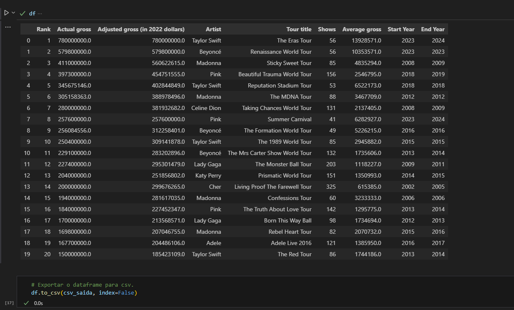

## Etapa II - job.py

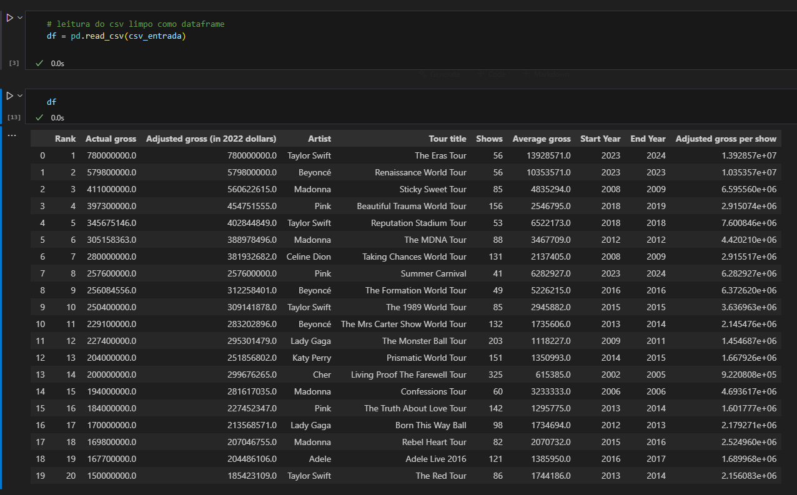

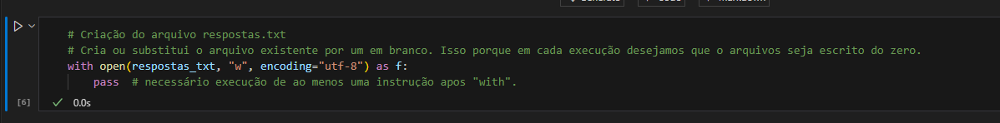

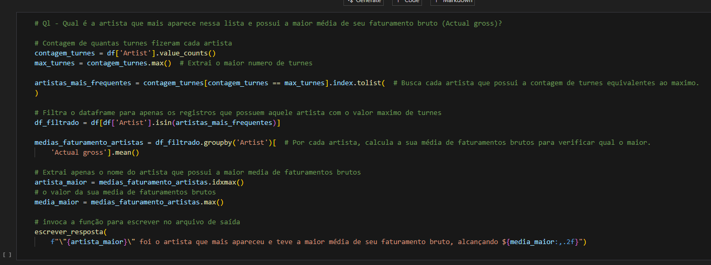

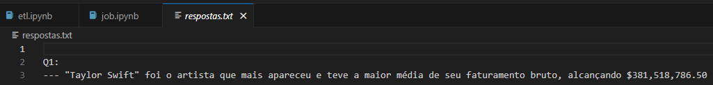

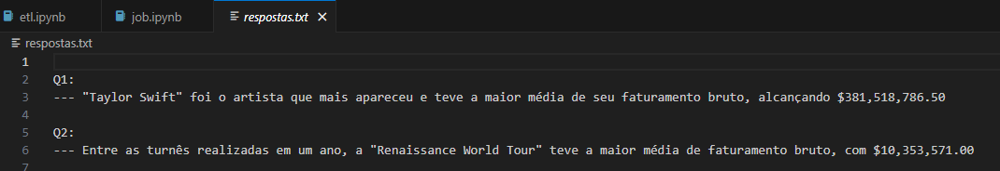

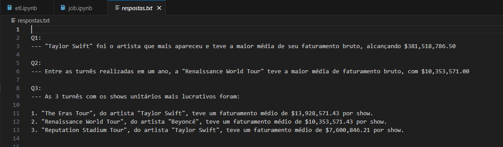

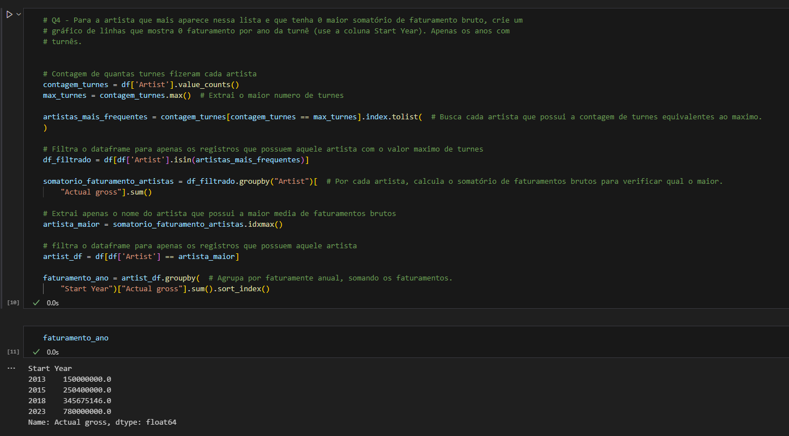

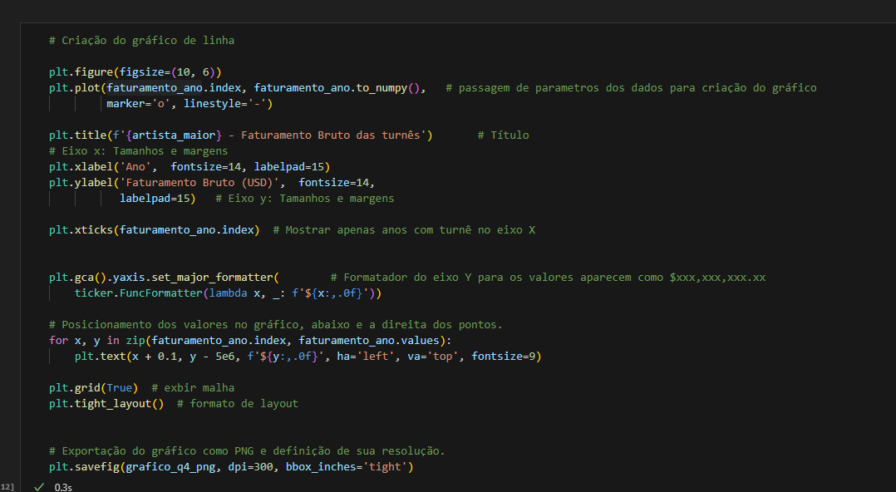

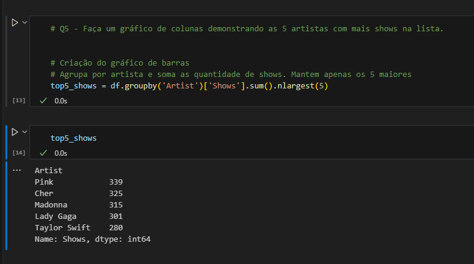

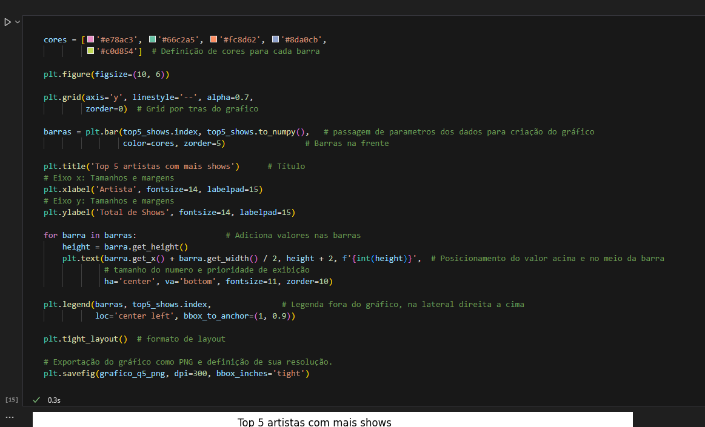

## Etapa III - docker-compose.yml

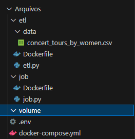

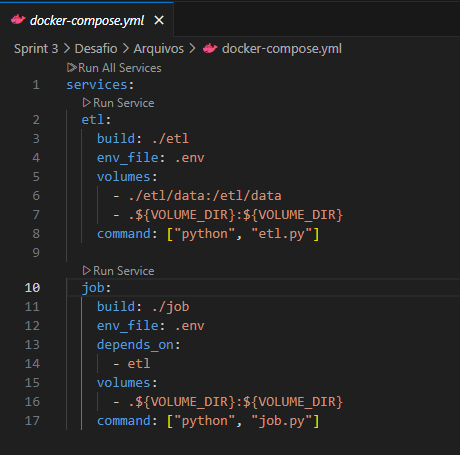

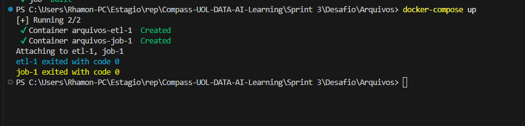

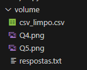