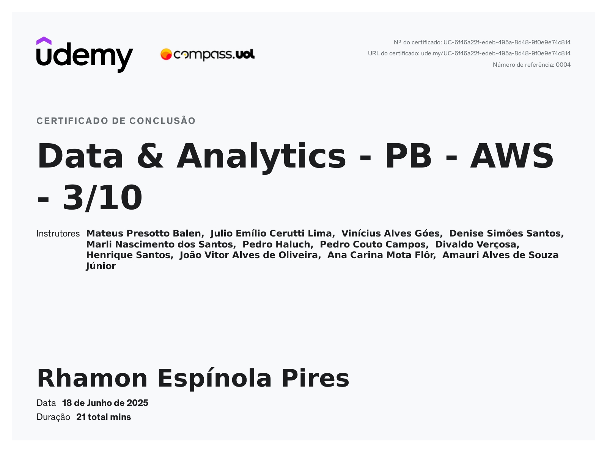

# Resumo

# Desafio

- [Arquivos](./Desafio/Arquivos/)
- [README.MD](./Desafio/README.md)

# Exercícios

## Etapa 1

- [Carguru.py](./Exercicios/Etapa%201/carguru.py)
- [Dockerfile](./Exercicios/Etapa%201/Dockerfile)

## Etapa 2

- [mascara-dados.py](./Exercicios/Etapa%202/mascara-dados.py)
- [Dockerfile](./Exercicios/Etapa%202/Dockerfile)

# Evidências

Aqui vão constar as evidências da execução com sucesso dos exercícios

## Etapa 1

## Etapa 2

# Certificados

### Certificado do AWS Technical Essentials

### Certificado do AWS Partner: Accreditation (Technical)

.png)

### Badge do AWS Partner: Accreditation (Technical)
Verificado em: [Credly](https://www.credly.com/badges/97a747f0-0a3f-45f0-ad96-6b8f1ff217d3)

### Certificado do Data & Analytics - PB - AWS - 2/10

