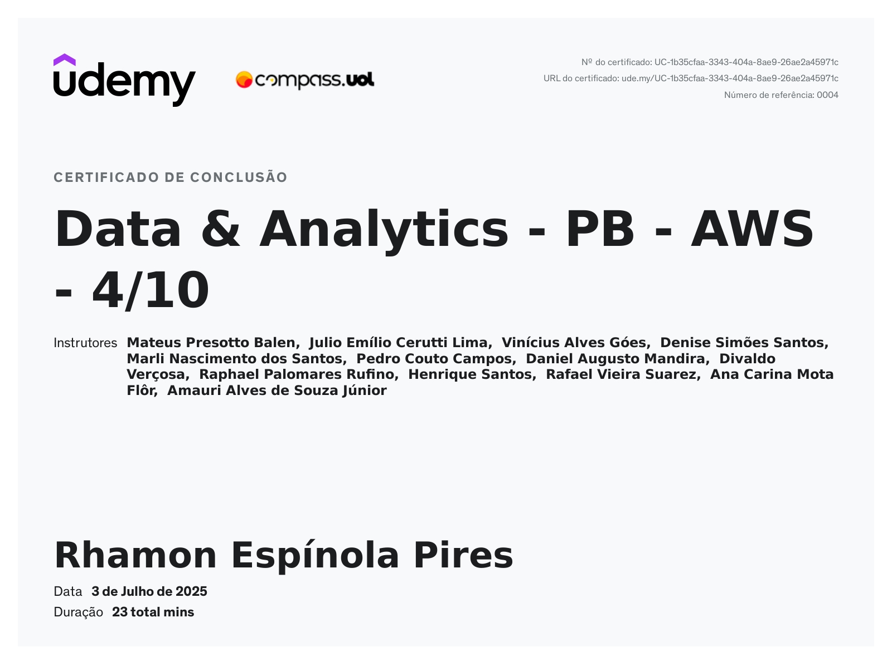

# Resumo

- Nesta semana, os estudos foram focados em três cursos da AWS Skill Builder, com o objetivo de entender melhor tanto a parte de negócios quanto a parte prática do uso da nuvem AWS.

- Os conteúdos mostraram como apresentar as soluções da AWS de forma clara para diferentes tipos de clientes, como destacar os benefícios financeiros de migrar para a nuvem, e ainda proporcionaram uma experiência prática e interativa sobre os principais serviços da AWS.

- Além disso, foi possível perceber como é importante ter uma visão completa, não só técnica, mas também estratégica, para atuar com soluções em nuvem, seja vendendo, planejando ou executando.

## AWS Partner: Sales Accreditation (Business)

- Esse curso foi voltado para a atuação na área comercial e precisa entender como posicionar a AWS como solução para os clientes.

- Foi possível aprender como mapear o momento atual de cada cliente (se estão iniciando ou já têm algum uso da nuvem), como apresentar as vantagens da AWS com base nas necessidades reais e como conduzir conversas mais estratégicas, focadas em valor de negócio e não apenas em tecnologia.

- Também foi reforçada a importância de alinhar as soluções da nuvem com os objetivos de cada empresa, mostrando como a AWS pode ajudar a atingir metas como inovação, redução de custos e crescimento sustentável.

## AWS Partner: Economias na nuvem AWS

- Esse curso mostrou como a AWS pode trazer economia para os clientes, especialmente quando comparada a ambientes locais (on-premises).

- Aprendemos a explicar de forma simples como funciona o modelo de pagamento por uso, e como isso pode ajudar empresas a gastarem apenas com o que realmente utilizam, evitando desperdícios.

- Também foram abordadas estratégias para otimizar custos usando escalabilidade automática, desligamento de recursos fora do horário de uso e migração de cargas para serviços gerenciados.

- Ferramentas como o AWS Pricing Calculator e estudos de caso ajudaram a visualizar melhor como apresentar esses ganhos aos clientes.

## AWS Cloud Quest: Cloud Practitioner

- Esse foi um curso mais dinâmico e prático, com uma proposta gamificada para aprender os conceitos básicos da nuvem AWS.

- Através de uma cidade virtual, assumimos o papel de um profissional de nuvem e resolvemos problemas de clientes simulados, o que ajudou a aplicar conceitos na prática.

- Foram abordados temas como computação, armazenamento, banco de dados, segurança e redes, sempre com foco em situações reais.

- Essa abordagem mais interativa ajudou a fixar melhor os serviços da AWS e entender como eles se encaixam no dia a dia de uma empresa que usa nuvem.

# Desafio

- [Arquivos](./Desafio/Arquivos/)
- [README.MD](./Desafio/README.md)

# Exercícios

## Etapa 1 - Lab AWS S3

Nessa etapa, criamos um bucket no Amazon S3 para hospedar um site estático. Configuramos o bucket para usar um arquivo index.html como página inicial e um arquivo 404.html para erros. Ajustamos as permissões do bucket, liberando o acesso público por meio do bloqueio de acesso e adicionando uma política que permite leitura pública dos arquivos. Em seguida, fizemos o upload do arquivo index.html e do CSV para o bucket, os organizando em pastas. Por fim, testamos o site acessando o endpoint gerado pelo S3, confirmando que o conteúdo está disponível online.

## Etapa 2 - Lab AWS Athena

Nessa etapa, usamos o AWS Athena para consultar dados armazenados no S3. Primeiro, verificamos se o arquivo nomes.csv estava no bucket criado, fazendo upload se necessário. Criamos uma pasta chamada queries para salvar os resultados das consultas. No Athena, configuramos esse bucket para armazenar os resultados e criamos um banco de dados chamado meubanco. Depois, construímos uma tabela externa baseada no arquivo CSV, definindo os tipos de dados e o formato correto para o Athena interpretar. Por fim, testamos a consulta para buscar dados específicos e criamos uma query para listar os 3 nomes mais usados por década desde 1950. 

## Etapa 3 - Lab AWS Lambda

Nesta etapa, criamos uma função Lambda em Python 3.9 para acessar um arquivo CSV no S3 e contar suas linhas usando as bibliotecas Pandas e Boto3. Como a Lambda não inclui Pandas por padrão, implementamos uma camada (Layer) para adicionar essa dependência. Utilizamos Docker com uma imagem Amazon Linux para instalar Pandas e suas dependências na estrutura correta (pasta python), compactamos tudo em um arquivo zip e copiamos para o ambiente local. Depois, enviamos esse arquivo para um bucket S3 e criamos a camada no console Lambda apontando para o zip no S3. Finalmente, vinculamos essa camada à função Lambda e executamos o teste com sucesso, retornando o número de linhas do arquivo CSV. Ajustes de memória e tempo de execução da função foram necessários para a execução com sucesso.

## Etapa 4 - Limpeza de Recursos

Após concluir os laboratórios e salvar todas as evidências/códigos no GitHub, realize a limpeza dos recursos criados para evitar custos desnecessários. Isso inclui, principalmente, excluir todos os arquivos usados ou gerados durante os laboratórios no bucket S3.

# Evidências

Aqui estão as capturas de tela que comprovam a execução do laboratório:

## Etapa 1: Lab AWS S3

## Etapa 2 - Lab AWS Athena

# Evidências do Lab AWS Athena

## Etapa 3 - Lab AWS Lambda

## Etapa 4 - Limpeza de Recursos

# Certificados

---

### AWS Partner - Sales Accreditation (Business)  
.png)

---

### AWS Partner - Cloud Economics  

---

### AWS Cloud Quest - Practitioner  

---

### Badges
Verificação em Credly: 
[Sales Accreditaton](https://www.credly.com/badges/370647c2-7627-452a-a4e1-7d6c391b0b18/public_url), 
[Cloud Economics](https://www.credly.com/badges/da79430d-b28e-4427-b1f6-42cdf1a91949/public_url),
[Cloud Practitioner](https://www.credly.com/badges/fd534686-7e6f-45d1-8641-cb1375fe7280/public_url)

---

    
    
    

---

### Certificado do Data & Analytics - PB - AWS - 4/10 

