# Etapas

1. [[ ETAPA 1 ] - Modelagem Dimensional](./Arquivos/modelo_dimensional.png)
2. [[ ETAPA 2 ] - Job Glue - Spark](./Arquivos/job_glue.py)

# Desafio Apresentado 

- O desafio foi focado na criação e modelagem da camada Refined do Data Lake, onde os dados já estão prontos para análise e extração. Essa camada recebe os dados processados e organizados a partir da camada Trusted.

- Nesta etapa, a tarefa principal é estruturar os dados conforme os princípios de modelagem multidimensional, permitindo consultas eficientes sob diferentes perspectivas.

- Utilizaremos o serviço AWS Glue para criar as tabelas e, se necessário, views no Glue Data Catalog, de modo que os dados possam ser disponibilizados para ferramentas de visualização, como o AWS QuickSight nas próximas sprints.

- O processamento foi realizado através de jobs em Apache Spark no Glue, que transformam e armazenam os dados da Trusted Zone na camada Refined baseado na modelagem dimensional, em formato Parquet, particionados para otimizar a visualização e consultas.

- A camada Refined é a base para análises avançadas e relatórios, integrando todo o conhecimento prático e técnico adquirido no programa.

# Desenvolvimento

- Primeiramente vale relembrar que a análise a ser desenvolvida é **"Análise dos fatores determinantes para o sucesso de filmes de baixo orçamento"**

- Dessa forma a ideia é analisar possiveis fatores de popularidade em nossos dados.

- Para isso foi necessário realizar a modelagem dimensional dos dados, com o objetivo de otimizar a visualização e as consultas em ambientes OLAP, facilitando análises rápidas e eficientes.

- Foi utilizada a ferramenta [dbdiagram.io](https://dbdiagram.io/) para realizar a modelagem. Segue o resultado abaixo e também um link diretamente para o diagrama:

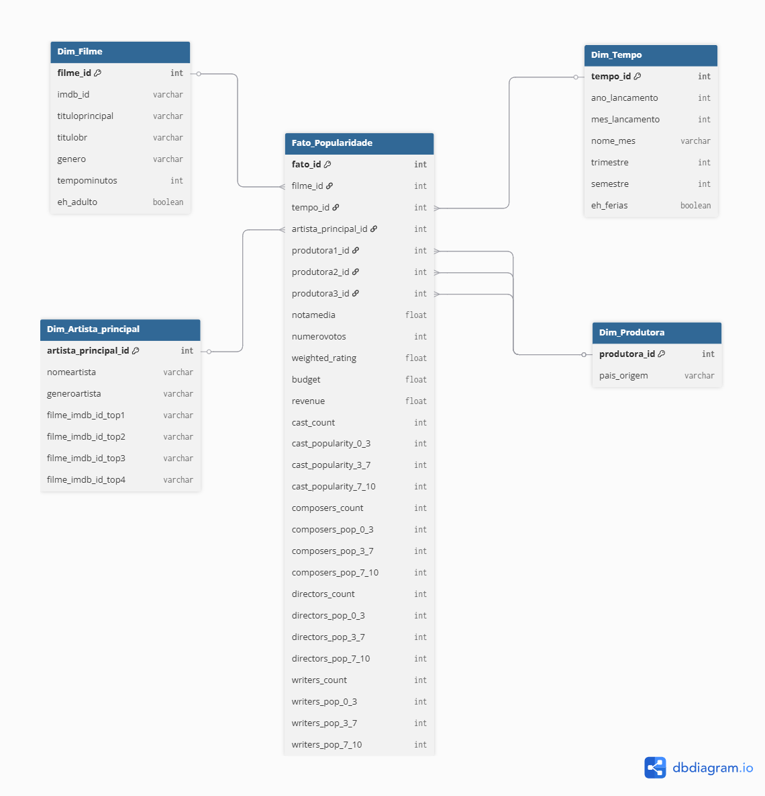

Pode ser acessado [aqui](https://dbdiagram.io/d/modelo_dimensional-68a3180fec93249d1e12388c)

### Estrutura da Modelagem

- O **fato central** da modelagem trata da **popularidade dos filmes**.

#### Dimensões de Interesse

- **Filme**  
  Utilizado para análise de características específicas das obras.

- **Artista principal**  
  Foco na presença de determinados atores, considerando também seus filmes mais bem avaliados, com o objetivo de investigar uma possível relação direta com a popularidade dos filmes analisados.

- **País de origem das produtoras**  
  Considera-se a influência do país produtor, sem necessidade de focar nos nomes específicos das empresas.

- **Tempo**  
  Análise por período, considerando trimestres e especialmente **períodos de férias escolares** (dezembro/janeiro e junho/julho), que podem impactar diretamente a recepção do público.

#### Métricas no Fato

- **Indicadores monetários**
  - Orçamento
  - Receita

- **Recepção do público**
  - Número de votos
  - Média das avaliações
  - Nota ponderada

- **Composição da equipe técnica e artística**
  - Quantidade de **atores, compositores, diretores e escritores**
  - Classificação por faixas de **popularidade**:
    - De 0 a 3
    - De 3 a 7
    - De 7 a 10

- O modelo adota a arquitetura estrela da modelagem dimensional, o que facilita consultas analíticas otimizadas e permite o particionamento eficiente dos dados com base na dimensão de tempo.

### Desenvolvimento do Glue job em Spark

- Inicialmente, temos as importações das bibliotecas padrão no modelo de um job Glue, além de bibliotecas e funções utilizadas para manipulação dos dados em Spark:

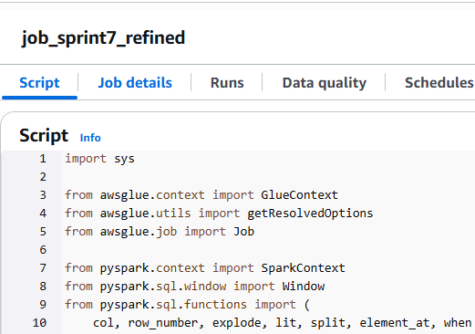

- Em seguida, é realizada a criação do contexto Spark e o recebimento dos argumentos passados como parâmetros de entrada. Aqui são definidos os caminhos no S3 para os dados da camada TRUSTED, tanto locais quanto da API. Por fim, também é passado o caminho da camada REFINED.

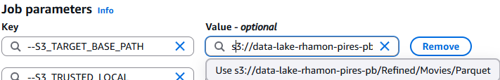

- Foi alterada a configuração do Spark relacionada ao "Broadcast join automático", pois ela estava causando falhas ao realizar joins entre as tabelas. Em seguida, é feita a leitura dos dados Parquet da camada TRUSTED.

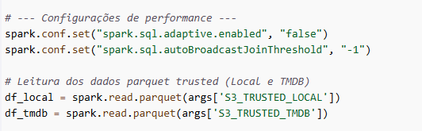

- É realizada a junção dos dados locais com os dados oriundos da API utilizando o ID do IMDb.

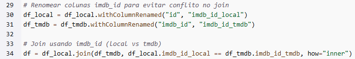

- A seguir, temos a construção da primeira dimensão: dimensão tempo. Aqui são utilizados os dados numéricos de ano e mês de lançamento de cada filme. Para fins de exibição futura, foi adicionado o nome do mês. Além disso, para possibilitar uma análise temporal mais rica, o mês foi desmembrado em semestre, trimestre e período de férias (dezembro/janeiro e junho/julho).

- Para a atribuição do ID da tabela, foi criada uma chave única (surrogate key) a partir de uma window (conjunto ordenado temporário), de forma que o ID seja relativo à posição sequencial da linha (1, 2, 3...). Essa lógica será aplicada também às demais tabelas de dimensão e fato.

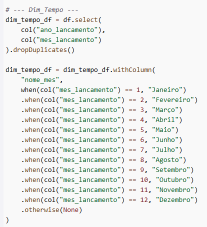

- Na dimensão **filme**, mantivemos apenas os dados textuais referentes ao filme. Houve duas exceções: o tempo em minutos e o ano/mês de lançamento. O tempo em minutos, por não ser uma informação diretamente relevante para nossa análise de popularidade, foi incluído na dimensão filme, pois não deve impactar consultas futuras. Já o ano e mês de lançamento foram mantidos para permitir o particionamento dos dados em formato Parquet.

- A surrogate key é criada com a mesma lógica utilizada na tabela anterior.

- A dimensão **artista principal** contém o nome, gênero e os 4 principais filmes do(a) artista. Como se trata de uma quantidade fixa de filmes, optei por manter os 4 campos separados para otimizar consultas. Como esse campo originalmente está em formato array, foi necessário extrair cada elemento individualmente.

- Na dimensão **produtora**, o único dado de interesse para a análise foi o local de produção.

- A função `explode` transforma cada elemento do array em uma linha única. Em seguida, eliminamos as duplicatas para garantir que cada país apareça apenas uma vez.

- A geração do ID segue a mesma lógica das outras dimensões.

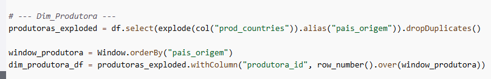

- Foi realizado o mapeamento das chaves para uso na construção da tabela fato.

- Como um filme pode ter múltiplas produtoras de países diferentes, limitei esse número a 3, seguindo a mesma lógica aplicada aos "principais filmes" dos artistas.

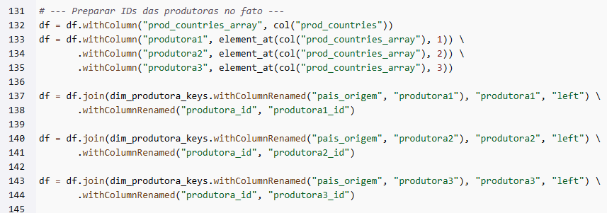

- Foram criados aliases (renomeações) para evitar ambiguidades durante o join com as dimensões **tempo** (necessário para particionamento) e **artista principal**.

- Foi construída a **tabela fato**, com os valores definidos conforme nossa modelagem dimensional.

  

- Por fim, armazenamos as tabelas em formato Parquet, particionando pelo tempo — tanto as dimensões quanto a tabela fato que têm relação com ele.

# Resultados

- Execução bem-sucedida do job no Glue, respeitando as configurações especificadas no desafio:

- Execução do crawler, criando as 5 tabelas e seus particionamentos:

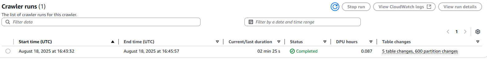

- Visualização dos databases:

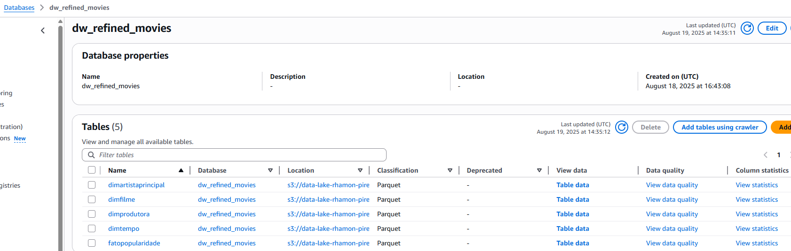

- Visualização dos schemas: 

  
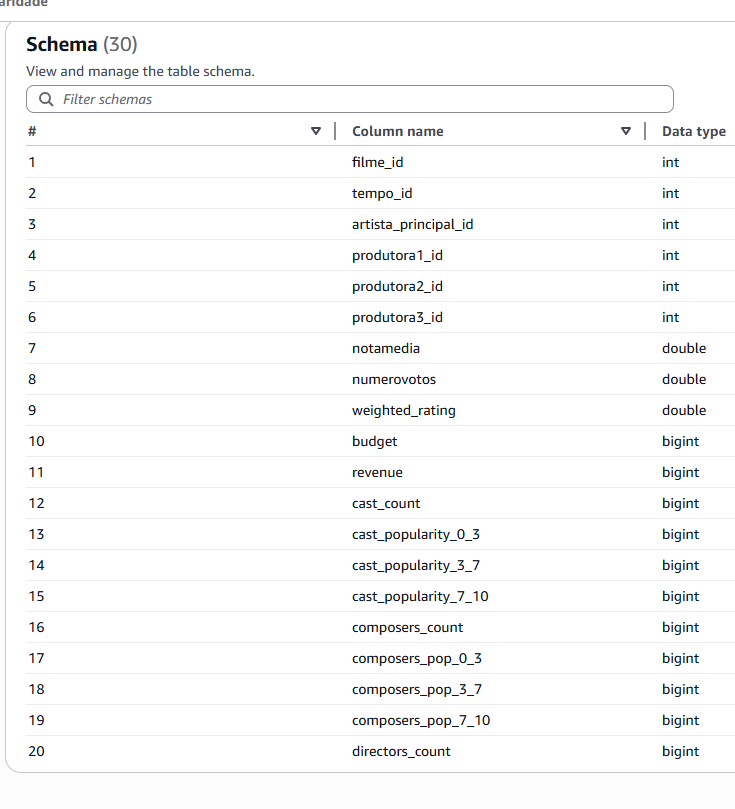  
  
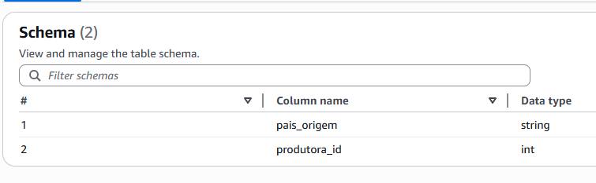  

- Consulta de teste no Athena:

