# Etapas

1. [[ ETAPA 1 ] - Modelagem Dimensional](./Arquivos/modelo_dimensional.png)
2. [[ ETAPA 2 ] - Job Glue - Spark](./Arquivos/job_glue.py)

# Desafio Apresentado 

- O desafio foi focado na criação e modelagem da camada Refined do Data Lake, onde os dados já estão prontos para análise e extração. Essa camada recebe os dados processados e organizados a partir da camada Trusted.

- Nesta etapa, a tarefa principal é estruturar os dados conforme os princípios de modelagem multidimensional, permitindo consultas eficientes sob diferentes perspectivas.

- Utilizaremos o serviço AWS Glue para criar as tabelas e, se necessário, views no Glue Data Catalog, de modo que os dados possam ser disponibilizados para ferramentas de visualização, como o AWS QuickSight nas próximas sprints.

- O processamento foi realizado através de jobs em Apache Spark no Glue, que transformam e armazenam os dados da Trusted Zone na camada Refined baseado na modelagem dimensional, em formato Parquet, particionados para otimizar a visualização e consultas.

- A camada Refined é a base para análises avançadas e relatórios, integrando todo o conhecimento prático e técnico adquirido no programa.

# Desenvolvimento

- Primeiramente vale relembrar que a análise a ser desenvolvida é **"Análise dos fatores determinantes para o sucesso de filmes de baixo orçamento"**

- Dessa forma a ideia é analisar possiveis fatores de popularidade em nossos dados.

- Para isso foi necessário realizar a modelagem dimensional dos dados, com o objetivo de otimizar a visualização e as consultas em ambientes OLAP, facilitando análises rápidas e eficientes.

- Foi utilizada a ferramenta [dbdiagram.io](https://dbdiagram.io/) para realizar a modelagem. Segue o resultado abaixo e também um link diretamente para o diagrama:

Pode ser acessado [aqui](https://dbdiagram.io/d/modelo_dimensional-68a3180fec93249d1e12388c)

### Estrutura da Modelagem

- O **fato central** da modelagem trata da **popularidade dos filmes**.

#### Dimensões de Interesse

- **Filme**  
  Utilizado para análise de características específicas das obras.

- **Artista principal**  
  Foco na presença de determinados atores, considerando também seus filmes mais bem avaliados, com o objetivo de investigar uma possível relação direta com a popularidade dos filmes analisados.

- **País de origem das produtoras**  
  Considera-se a influência do país produtor, sem necessidade de focar nos nomes específicos das empresas.

- **Tempo**  
  Análise por período, considerando trimestres e especialmente **períodos de férias escolares** (dezembro/janeiro e junho/julho), que podem impactar diretamente a recepção do público.

#### Métricas no Fato

- **Indicadores monetários**
  - Orçamento
  - Receita

- **Recepção do público**
  - Número de votos
  - Média das avaliações
  - Nota ponderada

- **Composição da equipe técnica e artística**
  - Quantidade de **atores, compositores, diretores e escritores**
  - Classificação por faixas de **popularidade**:
    - De 0 a 3
    - De 3 a 7
    - De 7 a 10

- O modelo adota a arquitetura estrela da modelagem dimensional, o que facilita consultas analíticas otimizadas e permite o particionamento eficiente dos dados com base na dimensão de tempo.

## Desenvolvimento do Glue job em Spark

- Inicialmente temos as importações das bibliotecas por padrão no mdelo de um job glue e tambem bibliotecas e funções que foram utilizadas para manipulação dos dados em Spark:

- Em seguida a criação do contexto spark e recebimento dos argumetnos passados por parametro de entrada. Aqui estarão o caminho do s3 para os dados TRUSTED tanto locais como da API. Por ultimo também é passado o caminho da nossa camada REFINED.

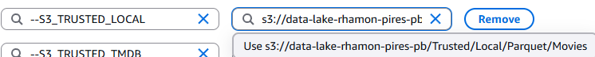

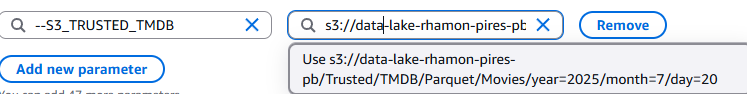

- Foi alterado a configuração do spark de "Broadcast join automático", porque estava ocasionando falha ao realizar o join nas tabelas. Em seguida é feita a leitura dos dados parque da camada trusted

- É realizado a junção dos dados locais e dos dados oriundos da API pelo id do imdb.

- Agora a construção da primeira dimensão: dimensão tempo. Aqui nos temos apenas os dados numéricos de ano e mes de lançamento de cada filme. Para exibição futuro uso de exibição foi adicionado o atributo do nome do mes. Alem disso, para termos uma melhor analise temporal de determinadas épocas do ano, destrinchamos o mes em semestre, trimestre e epoca de ferias (dezembro/janeiro e junho/julho)

- Para atribuição do id da tabela, foi criado a chave unica (surrogate keys) a partir de uma window (um conjunto ordenado temporario), para que o id seja relativo a posição da linha sequencialmente (1, 2, 3...). Essa logica ser aplicada tambem para as demais tabelas de dim e fato.

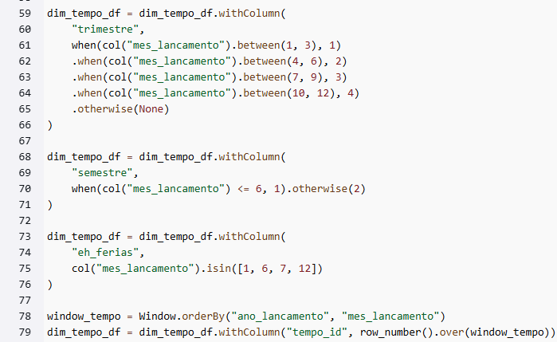

- Na dimensão filme, mantemos apenas os dados de textos referentes ao filme. Houveram duas ressalvas: o tempo em minutos e a ano_lançamento e mes_lançamento. A respeito do tempo. Por não se tratar de uma informação relevante no nosso fato de popularidade, decidi por colocar na dimensão do filme pois não parecia impactar nas futuras consultas para a analise. O ano e mes de lançamento são para efetuar o parcionamento dos filmes em parquet.

- É criado a surrogate key com a mesma logica da tabela passada.

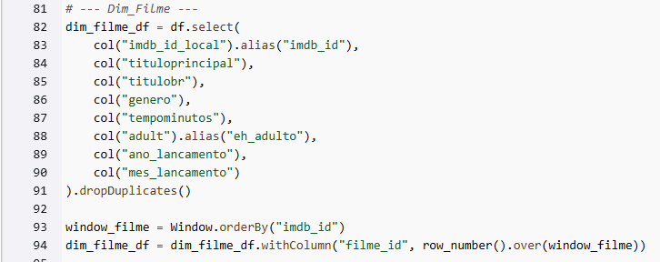

- A dimensão artista principal contem o nome, genero e os 4 principais filmes daquela artista. Já que seria uma quantidade fixa de filmes, optei por deixar os 4 campos separados afim de otimizar a consulta. Esse campo encontra-se como um array e foi necessario ser extraido cada elemento individualmente.

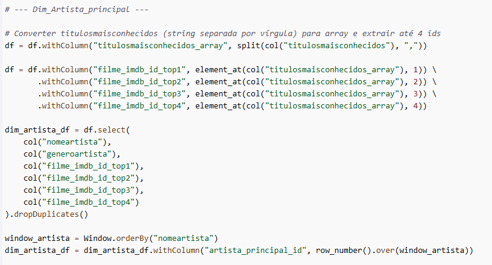

- A dimensão produtora so me interessei na analise pelo seu local de produção. 

- A funçsao explode transforma cada elemento do array em uma unica linha, e, em seguida, eliminamos as duplicadas garantindo que so haverá um pais sem repetição.

- segue a mesma logica para o id das dimensões anteriores.

- Realizado o mapeamento das chaves para ser usado na construção da tabela fato

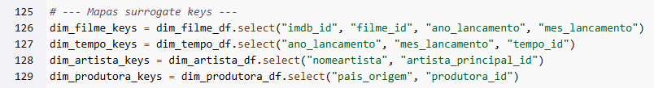

- Um filme poder ter multiplas produtoras de paises diferente, então optei por limitar em 3, seguindo a mesma logica dos "principais filmes" dos artistas.

- É feito aliases (renomeacões) afim de evitar ambiguidade na hora de fazer o join com as dimensoes tempo (para realizar o particionamento) e artista principal. 

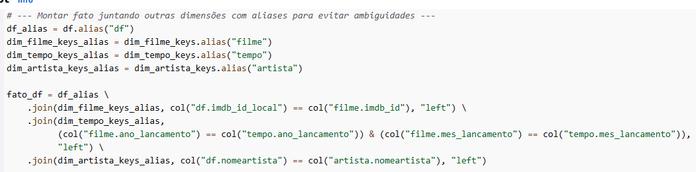

- É construida a tabela fato com os valores respectivos a nossa modelagem dimensional

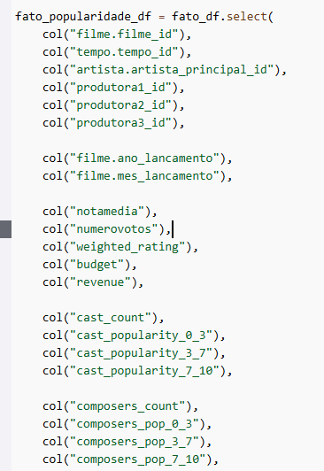
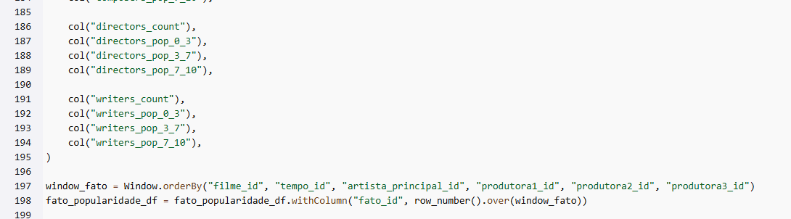

- Por ultimo armazenamos nossas tabelas em parquet particionando pelo tempo,as dimensoes e fato que são associadas ao tempo.

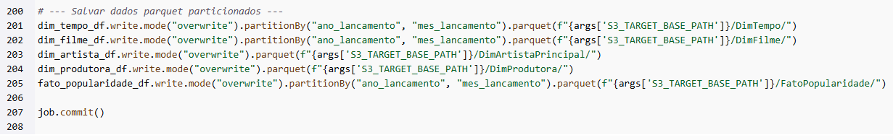

# Resultados

- Execução bem sucessida do job pelo Glue, respeito as configurações especificadas no desafio:

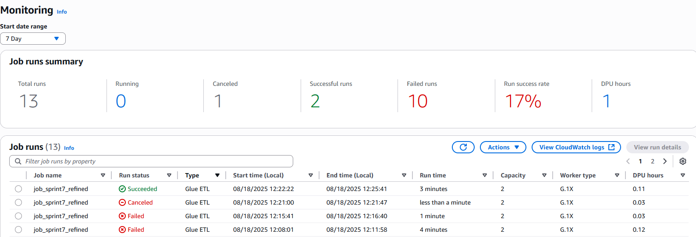

- Execução do crawler, criando as 5 tabelas e seus paricionamentos:

- Visualização dos databases:

- Visualização dos seus schemas: 

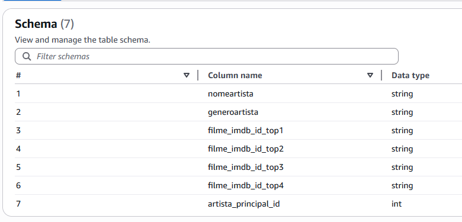

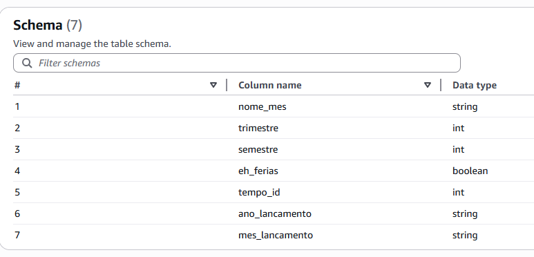

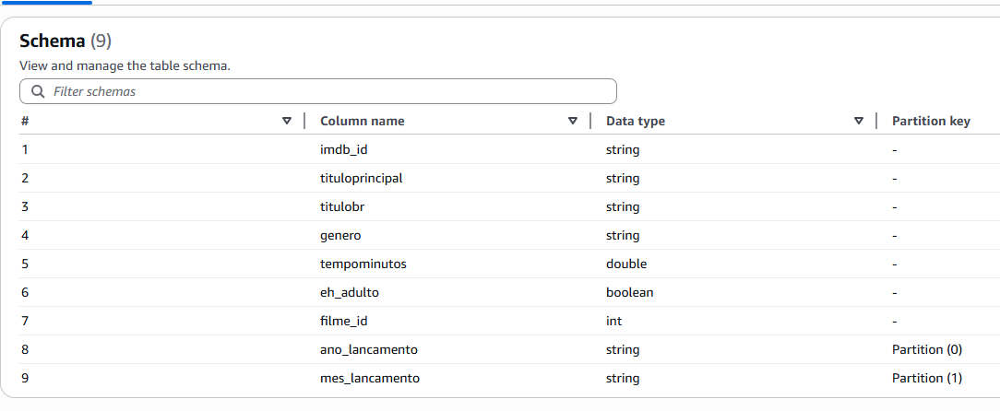

- Consulta teste no Athena:

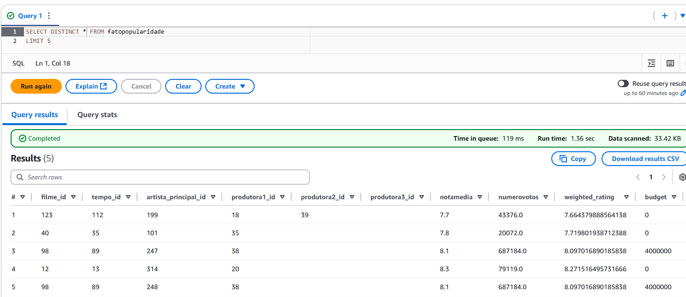