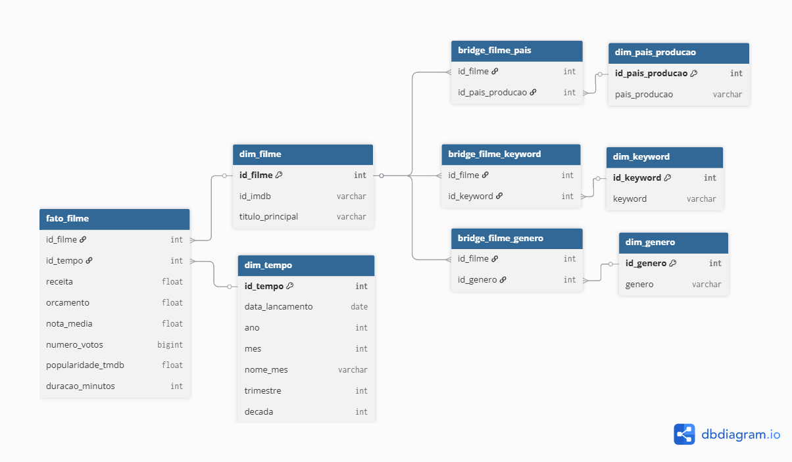
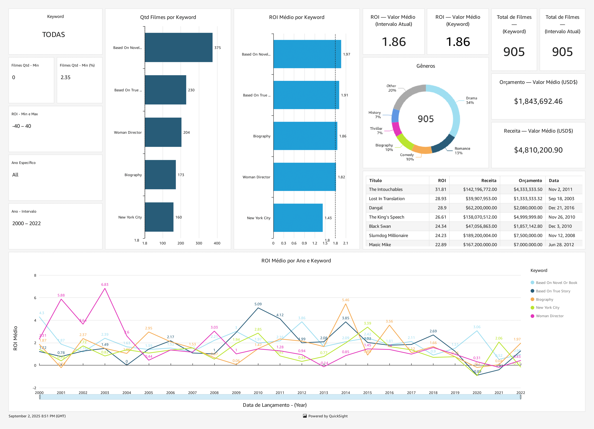
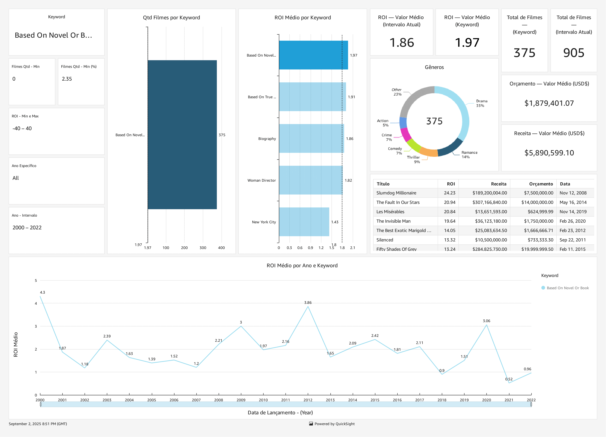

# Etapas

- Desenvolvimento da View e Dashboard final:

1. [[ Etapa 1 ] - Athena (View)](./Arquivos/Quicksight%20-%20View)

2. [[ Etapa 2 ] - Dashboard](./Arquivos/Dashboard/)

- Desenvolvimento dos novos códigos para atender aos requisitos das etapas anteriores do projeto: A estrutura dos códigos está organizada conforme as camadas do projeto, disponíveis nos respectivos diretórios:

1. [Camada RAW](./Arquivos/Raw/)

2. [Camada Trusted](./Arquivos/Trusted/)

3. [Camada Refined](./Arquivos/Refined/)

- Os códigos foram completamente reestruturados para seguir as boas práticas de desenvolvimento. Durante a revisão da análise anterior, identifiquei que o código original estava pouco organizado, com funções pouco modularizadas e subfunções não simplificadas.

- Agora, todos os scripts foram readequados para um padrão de qualidade superior, com funções bem definidas e responsabilidades claras, facilitando a manutenção e o entendimento.

# Desafio Apresentado

- Chegamos à última etapa do desafio, em que o foco deixa de ser apenas a ingestão, armazenamento e processamento dos dados, passando para o consumo e a extração de insights a partir deles.

- Nesta fase, o objetivo é criar um **dashboard no AWS QuickSight**, utilizando exclusivamente como fonte as tabelas disponíveis na camada **Refined** do Data Lake. O acesso a essas tabelas será feito por meio do **Athena**, configurado como datasource.

- O dashboard deve ser composto por diferentes visualizações que ofereçam uma visão consolidada e de alto nível sobre os dados, permitindo contar uma narrativa clara a partir das informações disponíveis. Para isso, é necessário explorar os recursos de visualização do QuickSight, organizando os dados em gráficos e análises que tragam valor e insights relevantes.

- Esta entrega representa o fechamento do ciclo do desafio, integrando todas as etapas anteriores (ingestão, tratamento, organização e disponibilização dos dados) e possibilitando a apresentação final em um formato visual e acessível.

# Desenvolvimento

Gostaria de reforçar que minha análise tem como título "Mapeamento de Palavras-chave Relevantes por Frequência e Retorno em Filmes de Drama e Romance".

A seguir, serão descritas as etapas realizadas para o desenvolvimento do desafio da sprint atual, focado na construção do dashboard.

# Etapa 1 - View no Athena

Antes de criar o dashboard no QuickSight, foi preciso organizar os dados em um único dataset. Como o QuickSight só permite usar **um dataset por dashboard**, a saída foi construir uma **view no Athena** que já trouxesse todos os elementos do modelo dimensional: a tabela fato, as dimensões e as bridges.  

## Modelo Dimensional
Para entender melhor o que seria necessário nessa view, primeiro damos uma olhada no **modelo dimensional**, que mostra como fato, dimensões e bridges se relacionam:

## Por que precisamos da view
O ponto mais delicado é que **cada filme pode estar ligado a múltiplos gêneros, múltiplas keywords e múltiplos países de produção**. Quando fazemos os joins, isso gera várias combinações, e as métricas **receita**, **orçamento** e **número de votos** acabam sendo replicadas, inflando os resultados.  

Para corrigir isso, foi criada uma CTE chamada `combinacoes_filme`. Nela, calculamos:  
- `qtd_generos` → quantos gêneros o filme tem  
- `qtd_keywords` → quantas keywords estão associadas  
- `qtd_paises` → em quantos países o filme foi produzido  
- `fator_divisao` → o produto desses três valores, ou seja, o total de combinações possíveis para aquele filme  

Esse **fator de divisão** serve como ajuste: sempre que somamos receita, orçamento ou votos, esses valores são divididos pelo fator, garantindo que **não fiquem multiplicados pelas repetições criadas nos joins**.

## Métricas ajustadas e fixas
- **Ajustadas pelo fator de divisão:** receita, orçamento, número de votos  
- **Não ajustadas (valores fixos por filme):** nota média, popularidade, duração em minutos  

## ROI já calculado na view
Outra etapa importante foi calcular já na view o **ROI (Return on Investment)**, definido como `(receita - orçamento) / orçamento`. Essa métrica conecta as keywords (atributos qualitativos) ao retorno financeiro (quantitativo) e era essencial para a análise da sprint **"Mapeamento de Palavras-chave Relevantes por Frequência e Retorno em Filmes de Drama e Romance"**.

## Campos adicionais
A view também traz:  
- Campos de tempo: ano, mês, trimestre, década  
- Informações das dimensões: título, gênero, keyword, país de produção  
- Colunas de apoio: fator de divisão e quantidades de gêneros, keywords e países  

Esses elementos permitem explorar os dados em cortes diferentes dentro do QuickSight, garantindo consistência e confiabilidade nas análises.

O código completo da view pode ser consultado aqui: [Athena (View)](./Arquivos/Athena%20-%20View/view_filme_completa.sql)

# Etapa 2 – Dashboard Interativo no QuickSight

Após a criação da view `view_filme_completa` no Athena — consolidando a tabela fato, as dimensões e as bridges em um único dataset — foi possível desenvolver um dashboard interativo no Amazon QuickSight. Esse dashboard foi projetado para explorar a relação entre palavras-chave (keywords) e retorno financeiro (ROI) em filmes dos gêneros Drama e Romance, lançados entre 2000 e 2022. A construção desse dashboard foi realizada com foco em maximizar a interatividade e a clareza na análise dos dados, facilitando a tomada de decisão estratégica.

## Objetivo da Análise

O objetivo central da análise é responder à pergunta:

> "Quais palavras-chave estão associadas a maior retorno financeiro em filmes de Drama e Romance?"

Mais do que simplesmente identificar palavras-chave com ROI alto, a análise leva em conta também a relevância e representatividade dessas palavras-chave dentro do conjunto de dados, considerando a frequência e consistência de sua presença em diversos filmes, para garantir que os insights gerados sejam sólidos e confiáveis.

### Sobre ROI (Retorno sobre Investimento):

ROI é uma métrica que indica quanto dinheiro um filme gerou em relação ao que foi investido na sua produção, geralmente expressa em porcentagem. Um ROI positivo, como 50%, significa que o filme retornou 50% a mais do que o valor investido, ou seja, se o orçamento foi R$ 1 milhão, o lucro foi de R$ 500 mil. Um ROI negativo indica prejuízo, ou seja, o filme não conseguiu recuperar o investimento. Quanto maior o ROI, melhor o retorno financeiro do filme em relação ao seu custo.

### Cuidado com Outliers: ROI Alto, mas Irrelevante?

Durante a navegação pelo dashboard, é possível encontrar keywords com ROIs extremamente altos, mas que estão presentes em apenas 1 ou 2 filmes. Embora esses dados sejam matematicamente válidos, eles representam pontos fora da curva e não fornecem uma base confiável para tomada de decisão.

Por isso, buscamos keywords que combinem dois critérios essenciais:

- **ROI consistente** – Indicador de rentabilidade ao longo de vários filmes, mostrando estabilidade e robustez nos resultados financeiros associados.
- **Presença relevante** – Quantidade razoável de filmes associados à keyword, garantindo representatividade estatística e evitando conclusões baseadas em amostras muito pequenas.

**Exemplo:** uma keyword com ROI médio de 25.0 presente em apenas 2 filmes é um potencial outlier, pois sua representatividade é baixa e pode distorcer a análise. Já uma keyword com ROI de 3.5 presente em 50 ou mais filmes representa uma tendência mais confiável e estável, refletindo um padrão consolidado.

O dashboard facilita a identificação visual desses casos, já que as palavras-chave com poucos filmes aparecem com barras pequenas no gráfico de "Quantidade de Filmes por Keyword". Além disso, o filtro lateral de "Quantidade mínima de filmes por keyword" permite remover rapidamente esses outliers da análise, ajustando dinamicamente os gráficos com base em critérios definidos pelo usuário e promovendo uma análise mais precisa e confiável.

## Navegação no Dashboard

O dashboard foi planejado para oferecer uma experiência de análise intuitiva e fluida. Seu layout foi propositalmente estruturado em uma única tela enxuta, para que todas as informações relevantes estivessem visíveis de forma simultânea e conectada, eliminando a necessidade de múltiplas abas ou páginas.

Além disso, o dashboard utiliza ações de clique ("actions"), permitindo que ao clicar em uma keyword nos gráficos, os demais gráficos e tabelas sejam automaticamente filtrados para refletir essa seleção. Isso torna a análise mais dinâmica e interativa, facilitando a exploração dos dados e promovendo insights mais rápidos.

Na lateral esquerda, há um conjunto adicional de filtros importantes para refinar ainda mais o conjunto de dados visualizados, tais como:

- **Filtro de quantidade mínima de filmes por keyword:** Para eliminar keywords pouco representativas, o usuário pode definir um valor mínimo absoluto ou percentual de filmes que a keyword deve ter para aparecer nas visualizações. Isso ajuda a evitar ruídos causados por palavras-chave raras que podem distorcer a análise e a garantir foco nos termos mais significativos.
- **Filtro de intervalo de ROI:** Permite selecionar um intervalo mínimo e máximo para o ROI das keywords, focando naquelas que apresentem rentabilidade dentro de um parâmetro definido pelo usuário. Isso possibilita análises segmentadas, como focar em palavras-chave com ROI superior a determinado valor, auxiliando na priorização de investimentos ou estratégias.
- **Filtro de intervalo de anos:** Possibilita limitar a análise a um período específico entre 2000 e 2022, facilitando a identificação de tendências temporais, ciclos de mercado ou impacto de contextos históricos sobre o desempenho financeiro das palavras-chave. Essa granularidade temporal é fundamental para entender mudanças no comportamento do mercado audiovisual ao longo dos anos.

Esses filtros laterais são fundamentais para garantir que a análise se concentre nas palavras-chave mais relevantes e confiáveis para tomada de decisão, personalizando o escopo conforme a necessidade do usuário.

## Estrutura do Dashboard

A disposição dos elementos no dashboard segue uma lógica pensada para comparação rápida e análise eficiente, com destaque para os seguintes componentes:

### Gráfico de barras – Quantidade de Filmes por Keyword

Permite identificar quais palavras-chave são mais utilizadas no universo analisado, evidenciando a popularidade e a abrangência dos temas.

### Gráfico de barras – ROI Médio por Keyword

Mostra o retorno financeiro médio de cada keyword, permitindo identificar aquelas associadas a melhores resultados e maior rentabilidade.

Esses dois gráficos foram colocados lado a lado propositalmente, de forma que o usuário possa verificar simultaneamente a frequência de uso e a rentabilidade média de cada keyword. Isso facilita a identificação de palavras-chave que são ao mesmo tempo populares e financeiramente eficazes, sendo as candidatas ideais para estratégias comerciais e de marketing.

### Gráfico de linha – Evolução Temporal do ROI por Keyword

Posicionado logo abaixo dos gráficos de barra, este gráfico é fundamental para observar a tendência das keywords ao longo do tempo. Ele mostra como o ROI médio de cada keyword se comportou em diferentes anos, revelando ciclos, quedas, picos ou estabilidade de retorno ao longo das décadas.

O posicionamento direto abaixo dos gráficos de barra permite uma navegação fluida: o usuário pode clicar em uma keyword nos gráficos superiores e imediatamente ver como ela evoluiu ao longo do tempo no gráfico de linha inferior, sem trocar de aba ou rolar muito a página, promovendo análises temporais integradas e rápidas.

### Gráfico de pizza – Distribuição dos Gêneros Associados

Embora o dataset considere apenas filmes que contenham Drama e/ou Romance, cada filme pode estar vinculado a múltiplos gêneros, dada a relação muitos-para-muitos na modelagem dimensional. O gráfico de pizza apresenta a distribuição dos subgêneros relacionados a esses filmes, evidenciando temas complementares, como Comédia, Crime, Ação, entre outros.

Essa visualização é útil para contextualizar as keywords, mostrando como certos temas adicionais aparecem junto com as palavras-chave selecionadas. Por exemplo, a keyword *Based on Novel or Book* apresenta, além dos gêneros principais, presença de subgêneros como Comédia e Crime, ainda que em menor proporção, indicando a diversidade temática dos filmes associados e enriquecendo a compreensão do contexto dos dados.

### Tabela detalhada de filmes

Ao selecionar uma keyword, uma tabela exibe os principais filmes relacionados a ela, apresentando colunas com informações essenciais como:

- Título (nome do filme)
- ROI (retorno sobre investimento)
- Receita
- Orçamento
- Data (ano de lançamento)

Essa tabela oferece uma visão clara e objetiva dos filmes que compõem a análise da palavra-chave selecionada, permitindo ao usuário explorar os dados de forma granular e entender melhor a composição dos KPIs agregados. Ao focar nas informações financeiras e temporais essenciais, o dashboard mantém a simplicidade e facilita a tomada de decisão sem perder a profundidade necessária para análises detalhadas.

### KPIs principais

Na parte superior ou lateral do dashboard, KPIs resumem informações-chave sobre o conjunto atual de dados filtrado, como: média de ROI, receita média, orçamento médio, número total de filmes, entre outros indicadores importantes para contextualizar a análise. Esses KPIs fornecem uma visão rápida e consolidada do panorama financeiro e quantitativo do conjunto analisado, auxiliando o usuário a compreender o cenário geral antes de aprofundar-se em detalhes.

## Benefícios da Abordagem Interativa

A interação direta com o dashboard permite que o usuário:

- Explore diferentes palavras-chave e suas métricas associadas, promovendo uma análise personalizada e dinâmica.
- Evite conclusões precipitadas baseadas em outliers, graças aos filtros e visualizações que evidenciam a representatividade dos dados.
- Compare visualmente frequência de uso e retorno financeiro, facilitando decisões informadas sobre quais palavras-chave priorizar.
- Identifique tendências de longo prazo ligadas a temas específicos, ampliando a compreensão sobre a evolução do mercado.
- Navegue entre filtros e visualizações sem sair da mesma tela, tornando a análise mais ágil e eficiente.
- Analise filmes específicos e seus KPIs para cada palavra-chave selecionada, possibilitando decisões embasadas em dados granulares e confiáveis.

## Confiabilidade dos Dados

Graças ao tratamento feito na view `view_filme_completa`, os dados do dashboard estão livres de distorções causadas por joins com múltiplas cardinalidades (gênero × keyword × país). O uso do fator de divisão garante que as métricas financeiras reflitam valores reais por filme, mesmo em situações com múltiplas associações, assegurando a precisão dos resultados financeiros apresentados e a integridade da análise.

## Conclusão

O dashboard foi construído com foco em clareza, eficiência e interatividade. Ao integrar as principais visualizações e filtros em um único espaço, ele facilita a comparação entre relevância e retorno, ao mesmo tempo que permite investigar tendências temporais e dados granulares com apenas alguns cliques.

Com isso, torna-se uma ferramenta estratégica para identificar palavras-chave com real potencial comercial, evitando distorções por outliers e priorizando insights consistentes e acionáveis dentro do universo de filmes de Drama e Romance, contribuindo para decisões mais seguras e baseadas em dados sólidos.

# Resultados
